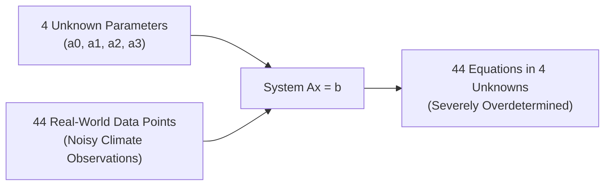
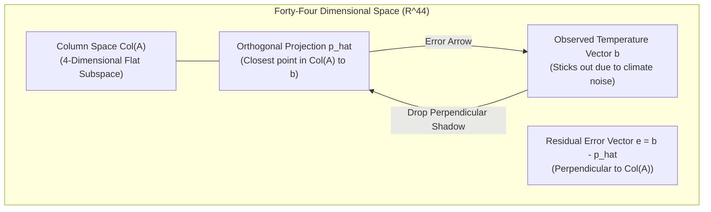
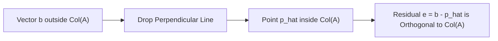
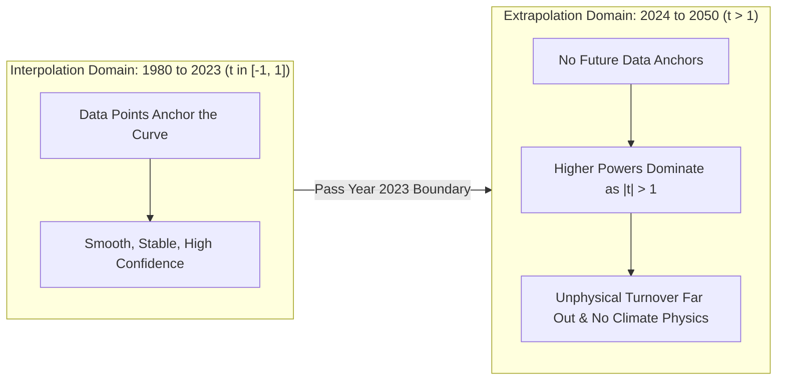
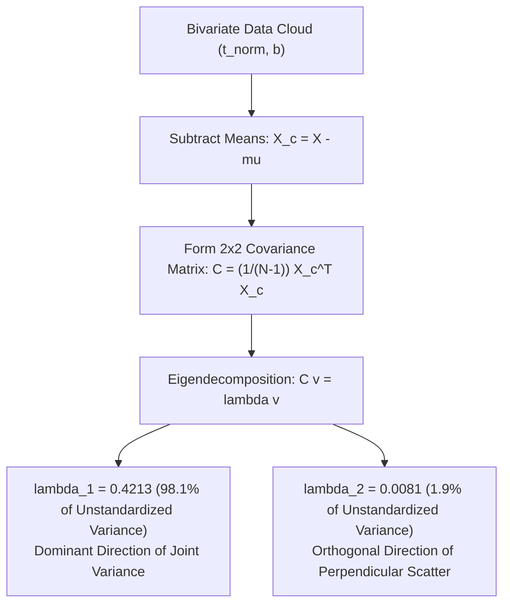

# Intuitive Guide to the Climate Change Linear Algebra Project

## The Big Picture Question

Start by forgetting matrices, vectors, and theorems for just one minute. 

Look at what we actually have: forty-four numbers representing global temperature anomalies measured by NASA from 1980 to 2023. If you plot them on a sheet of paper with years on the horizontal axis and temperature on the vertical axis, you see a jagged, noisy line that crawls steadily upward by about one degree Celsius over four decades.

Now suppose someone asks you two questions. First, what was the temperature in the middle of 1995, even if no single annual average sits precisely on July 1st? Second, what is the temperature likely to look like in 2030 or 2050 if this trajectory keeps moving?

The first question is interpolation. The second question is extrapolation. Both questions require drawing a smooth mathematical curve through that noisy scatter plot. 

The entire goal of this project is to figure out how to draw that curve without using any machine learning shortcuts, black-box libraries, or magical formulas, but purely through the geometric machinery of linear algebra.

---

## The Trap of Trying to Fit Data Exactly

When you first learn curve fitting in school, you are taught that two points define a unique line, three points define a unique parabola, and four points define a unique cubic polynomial.

So your first instinct might be: let us just find a cubic polynomial that passes through our data points. A cubic polynomial has the equation:

$$y(t) = a_0 + a_1 t + a_2 t^2 + a_3 t^3$$

Notice something here — this equation has exactly four unknown knobs you can turn: the coefficients $a_0, a_1, a_2$, and $a_3$.

Now here is the thing. We do not have four data points. We have forty-four data points. 

If you demand that one cubic curve must pass through every single one of those forty-four points simultaneously, you are demanding that four unknown numbers satisfy forty-four separate equations at the same time.

The moment you write down forty-four equations for four unknowns, basic algebra tells you that unless all forty-four points lie on an impossibly pristine, frictionless mathematical curve, no solution exists. 

Real-world temperatures fluctuate because of volcanic dust, El Nino cycles, and ocean currents. The data is noisy. The points will never line up perfectly.

---

## Converting the Physical Problem into a Matrix Equation

To see this problem clearly, we translate our forty-four individual equations into a single compact matrix equation:

$$A x = b$$

Here is how each piece maps directly to reality.

The vector $b$ on the right side is simply the list of our forty-four observed temperatures stacked vertically into a column vector in forty-four dimensional space ($\mathbb{R}^{44}$).

The vector $x$ is the column of four unknown polynomial coefficients $[a_0, a_1, a_2, a_3]^T$ living in $\mathbb{R}^4$.

The matrix $A$ is our design matrix. Each row corresponds to a specific year, and the four columns represent the polynomial powers of time evaluated at that year: the constant term $1$, the linear term $t$, the quadratic term $t^2$, and the cubic term $t^3$. Because of this power structure, mathematicians call $A$ a Vandermonde matrix.

$$\begin{bmatrix} 1 & t_1 & t_1^2 & t_1^3 \\ 1 & t_2 & t_2^2 & t_2^3 \\ \vdots & \vdots & \vdots & \vdots \\ 1 & t_{44} & t_{44}^2 & t_{44}^3 \end{bmatrix} \begin{bmatrix} a_0 \\ a_1 \\ a_2 \\ a_3 \end{bmatrix} = \begin{bmatrix} b_1 \\ b_2 \\ \vdots \\ b_{44} \end{bmatrix}$$

Notice something important about the time variable $t$. If you plug raw calendar years like 2023 directly into $A$, the fourth column contains numbers like $2023^3 \approx 8.27 \times 10^9$. 

When you later compute $A^T A$, you end up multiplying terms like $t^3 \times t^3 = t^6$, producing numbers on the order of $10^{19}$. Meanwhile, the first column only contains ones. 

Mixing numbers like $1$ and $10^{19}$ inside the same matrix creates massive numerical instability, known as an astronomical condition number. Computers start rounding off critical digits, and Gaussian elimination produces pure garbage.

So what do we do? We normalize the calendar years. We map the entire forty-four-year span from 1980 to 2023 into the neat interval between $-1.0$ and $+1.0$. Now, every single number inside matrix $A$ stays strictly between $-1$ and $+1$. Floating-point rounding errors vanish, and the matrix operations remain rock solid.

---

## Watching the System Break: Gaussian Elimination and RREF

Alright, so we have built $Ax = b$. We suspect there is no exact solution, but how do we prove it mathematically?

We use Gaussian elimination with partial pivoting to reduce our matrix to Reduced Row Echelon Form (RREF). 

Think about what RREF actually does. It is a systematic process of row addition and scaling that reveals the true underlying relationships between equations, stripping away all redundancies.

When we compute the RREF of the coefficient matrix $A$ alone, we find four leading ones (pivots). That means all four columns are linearly independent, giving $\text{rank}(A) = 4$. So far, so good.

But look at what happens when we attach our observed temperature vector $b$ to the right side and compute the RREF of the augmented matrix $[A \mid b]$.

The first four rows look normal. But look at the fifth row. The left side is all zeros, but the right side has a non-zero number:

$$\begin{bmatrix} 0 & 0 & 0 & 0 & \mid & 1 \end{bmatrix}$$

Translate that row back into an ordinary algebraic equation. It is saying:

$$0 \cdot a_0 + 0 \cdot a_1 + 0 \cdot a_2 + 0 \cdot a_3 = 1 \implies 0 = 1$$

This is a flat-out mathematical contradiction. 

Counting the pivot rows in $[A \mid b]$ gives five pivots, meaning $\text{rank}([A \mid b]) = 5$. 

By the classical Rouche-Capelli theorem, whenever $\text{rank}(A) < \text{rank}([A \mid b])$, the system is strictly inconsistent. No combination of coefficients can ever satisfy the equations. The system is dead on arrival.

---

## The Geometry of Why It Failed: Subspaces and Shadows

Now, do not treat that inconsistency as a dead end. Treat it as a geometric map. 

Ask yourself: why did the system fail geometrically?

Our temperature observation vector $b$ has forty-four entries. That means $b$ is a single arrow pointing somewhere in forty-four dimensional space ($\mathbb{R}^{44}$).

Now think about what $A x$ actually does. Matrix multiplication $A x$ is just a recipe for taking linear combinations of the columns of $A$:

$$A x = a_0 \mathbf{a}_0 + a_1 \mathbf{a}_1 + a_2 \mathbf{a}_2 + a_3 \mathbf{a}_3$$

The set of all possible outputs our model can ever generate is the column space of $A$, written $\text{Col}(A)$. 

Because $A$ has four linearly independent columns, $\text{Col}(A)$ is a 4-dimensional flat subspace cutting through forty-four dimensional space.

Notice the conflict: our data point $b$ lives in $\mathbb{R}^{44}$, but our model is trapped inside the 4-dimensional subspace $\text{Col}(A)$. 

Because climate data contains random noise, vector $b$ does not lie inside $\text{Col}(A)$. It sticks out into forty-four dimensional space like a flagpole pointing away from a tabletop. 

Demanding an exact solution $A x = b$ means searching inside the 4D tabletop for a vector that matches an arrow sticking up into the room. It is physically and mathematically impossible.

What about the null space $\text{Null}(A)$? 

By the Rank-Nullity Theorem:

$$\text{nullity}(A) = \text{number of columns} - \text{rank}(A) = 4 - 4 = 0$$

The null space contains only the zero vector $\mathbf{0}$. 

This is good news. It tells us that no non-zero combination of polynomial coefficients can produce a flat zero curve. Once we find our best-fitting curve, those coefficients will be strictly unique. There are no redundant degrees of freedom.

---

## Dropping the Shadow: Orthogonal Projection

So we cannot reach $b$. What is the next best thing?

If you cannot reach an arrow sticking up into the room, you look down at the tabletop and find the shadow directly beneath it. 

The point on the tabletop closest to the tip of that arrow is its orthogonal projection, denoted $\hat{p}$:

Geometrically, the distance between $b$ and any point $A x$ in the subspace is the length of the error vector:

$$\|e\| = \|b - A x\|$$

By the Pythagorean theorem in $\mathbb{R}^{44}$, this distance is smallest if and only if the error vector $e = b - \hat{p}$ drops straight down onto the subspace at a perfect ninety-degree angle:

$$e \perp \text{Col}(A)$$

Being perpendicular to the entire subspace means that $e$ must be perpendicular to every single column of matrix $A$:

$$\mathbf{a}_j^T (b - A \hat{x}) = 0 \quad \text{for } j = 0, 1, 2, 3$$

Stack all four conditions into one matrix equation:

$$A^T (b - A \hat{x}) = \mathbf{0}$$

Distribute $A^T$:

$$A^T b - A^T A \hat{x} = \mathbf{0} \implies A^T A \hat{x} = A^T b$$

Notice what just happened. The impossible $44 \times 4$ system $A x = b$ has collapsed into a square, balanced $4 \times 4$ system called the Normal Equations. 

Because the columns of $A$ are linearly independent, the $4 \times 4$ matrix $A^T A$ is guaranteed to be symmetric and invertible. We can solve for $\hat{x}$ directly:

$$\hat{x} = (A^T A)^{-1} A^T b$$

Multiply by $A$ on the left, and you get the projected point:

$$\hat{p} = A \hat{x} = A (A^T A)^{-1} A^T b = P_{\text{proj}} b$$

The matrix $P_{\text{proj}} = A(A^T A)^{-1} A^T$ is our projection matrix. It takes any vector in forty-four dimensional space and drops it straight down into its optimal shadow inside $\text{Col}(A)$.

---

## Straightening the Grid: Gram-Schmidt Orthogonalization

Now, think about this from a computational perspective. 

To solve $A^T A \hat{x} = A^T b$, we have to form $A^T A$ and solve it. But why were the columns of $A$ messy in the first place?

Because the monomial columns of $A$ ($1, t, t^2, t^3$) are not perpendicular. On the interval $[-1, 1]$, the column for $1$ and the column for $t^2$ point somewhat in the same direction. They are skewed, like trying to build a grid system using chopsticks that meet at twenty-degree angles instead of ninety degrees.

Gram-Schmidt orthogonalization is a procedure that takes those skewed vectors and systematically straightens them into an orthonormal basis:

$$Q = \begin{bmatrix} q_0 & q_1 & q_2 & q_3 \end{bmatrix}$$

Here is how the algorithm works mentally. 

You take the first column of $A$ and divide it by its length to make it a unit vector. That is $q_0$.

Then you take the second column of $A$. It probably has some component pointing along $q_0$. You calculate that projection, subtract it off, and whatever remains is guaranteed to be perpendicular to $q_0$. You normalize that remainder to get $q_1$.

You repeat this process for the third and fourth columns, subtracting off their projections onto all preceding $q$ vectors before normalizing.

| Basis Vector | Starting Column | Subtraction Step | Physical Property |
| :--- | :--- | :--- | :--- |
| $q_0$ | Column 0 ($1$) | None | Unit length baseline |
| $q_1$ | Column 1 ($t$) | Subtract projection onto $q_0$ | Orthogonal to $q_0$ |
| $q_2$ | Column 2 ($t^2$) | Subtract projections onto $q_0, q_1$ | Orthogonal to $q_0, q_1$ |
| $q_3$ | Column 3 ($t^3$) | Subtract projections onto $q_0, q_1, q_2$ | Orthogonal to $q_0, q_1, q_2$ |

Once you finish, you have factored our matrix into:

$$A = Q R_{\text{gs}}$$

where $Q$ has orthonormal columns ($Q^T Q = I_4$) and $R_{\text{gs}}$ is an upper-triangular matrix holding the projection coefficients.

Why does this matter? Because once your basis is orthonormal, projecting any vector $b$ onto the subspace becomes trivial:

$$\hat{p} = Q Q^T b$$

There is no matrix inversion required. You avoid all risk of ill-conditioned matrices. 

Even better: we can use $Q$ and $R_{\text{gs}}$ to solve directly for our polynomial coefficients. Because $A = Q R_{\text{gs}}$, the normal equations $(A^T A)\hat{x} = A^T b$ reduce immediately to:

$$R_{\text{gs}} \hat{x} = Q^T b$$

Because $R_{\text{gs}}$ is upper-triangular, we solve this directly by back-substitution from the bottom up. No matrix inversion of $A^T A$ is ever needed, preserving numerical precision.

A quick technical note: this algorithm is Classical Gram-Schmidt (CGS). On massive or poorly conditioned matrices, Classical Gram-Schmidt can lose orthogonality due to roundoff errors (where Modified Gram-Schmidt is preferred). But because we normalized our years to $[-1, 1]$, our matrix is well-conditioned, and $Q^T Q = I_4$ holds to machine precision.

---

## Inspecting System Conditioning via Eigenvalues of Matrix Transpose Times Matrix

Before proceeding to predictions, look at why normalization was so mathematically vital. 

In linear algebra, a matrix equation $A x = b$ can be numerically fragile. If the condition number $\kappa(A)$ is huge, tiny rounding errors in floating-point hardware blow up into giant errors in the calculated coefficients.

How do we measure the conditioning of our least squares system? By computing the eigenvalues of $A^T A$:

$$(A^T A) v = \lambda v$$

The condition number of $A^T A$ is given by the ratio of its largest eigenvalue to its smallest eigenvalue:

$$\kappa(A^T A) = \frac{\lambda_{\max}(A^T A)}{\lambda_{\min}(A^T A)}$$

The condition number of the design matrix $A$ itself is simply the square root: $\kappa(A) = \sqrt{\kappa(A^T A)}$.

Look at what we get for our normalized matrix ($t \in [-1, 1]$):

$$\lambda_1 = 0.8096, \quad \lambda_2 = 3.7744, \quad \lambda_3 = 21.7286, \quad \lambda_4 = 49.8566$$

All four eigenvalues are positive, confirming that $A^T A$ is strictly positive definite. 

Now compute the condition numbers:

$$\kappa(A^T A) = \frac{49.8566}{0.8096} \approx 61.58 \implies \kappa(A) = \sqrt{61.58} \approx 7.85$$

A condition number of $7.85$ is exceptionally small. In double-precision arithmetic, this guarantees that we lose less than a single decimal digit of numerical precision during matrix operations.

Now contrast that with what happens if you do not normalize and use raw calendar years ($1980, 1981, \dots, 2023$):

$$\kappa(A_{\text{raw}}) \approx 4.01 \times 10^{16}$$

Double-precision floating-point numbers provide about 16 decimal digits of accuracy (machine epsilon $\approx 1.1 \times 10^{-16}$). A condition number of $10^{16}$ completely wipes out all reliable digits, producing catastrophic cancellation. 

Computing the eigenvalues of $A^T A$ proves that time normalization was not a cosmetic tweak, but a strict mathematical necessity for stable linear algebra.

---

## The Honest Truth About Model Degree Selection

Now look at the choice of polynomial degree. Why did we pick a cubic polynomial ($y(t) = a_0 + a_1 t + a_2 t^2 + a_3 t^3$)?

We evaluated polynomials from degree 1 all the way to degree 6 using training fit ($R^2$), penalization for parameter count (Adjusted $R^2$), Leave-One-Out Cross-Validation (LOOCV), and an unobserved forward temporal holdout test (training on 1980–2013 and testing on 2014–2023):

| Degree | Model Formula | $R^2$ | Adjusted $R^2$ | LOOCV Error | Forward Holdout Error (2014–23) | 2050 Forecast |
| :--- | :--- | :--- | :--- | :--- | :--- | :--- |
| **1 (Linear)** | $a_0 + a_1 t$ | $0.8674$ | $0.8642$ | $0.01046$ | $0.02959$ | $+1.50^\circ\text{C}$ |
| **2 (Quadratic)** | $a_0 + a_1 t + a_2 t^2$ | $0.8855$ | $\mathbf{0.8800}$ | $\mathbf{0.00951}$ | $\mathbf{0.02129}$ | $+2.04^\circ\text{C}$ |
| **3 (Cubic)** | $a_0 + a_1 t + a_2 t^2 + a_3 t^3$ | $0.8857$ | $0.8771$ | $0.01018$ | $0.19396$ | $+1.84^\circ\text{C}$ |
| **4 (Quartic)** | Degree 4 | $0.8881$ | $0.8767$ | $0.01049$ | $0.19522$ | $+5.24^\circ\text{C}$ |
| **5 (Quintic)** | Degree 5 | $0.8897$ | $0.8752$ | $0.01164$ | $0.54480$ | $-6.12^\circ\text{C}$ |
| **6 (Sextic)** | Degree 6 | $0.8897$ | $0.8718$ | $0.01357$ | $11.53812$ | $-4.36^\circ\text{C}$ |

Notice something here — this table reveals a stark truth: **degree 2 beats degree 3 across every single model selection metric**.
- Adjusted $R^2$ peaks at degree 2 ($0.8800$) and drops at degree 3 ($0.8771$).
- Leave-one-out CV error is lowest for degree 2 ($0.00951$) and higher for degree 3 ($0.01018$).
- In the forward temporal holdout test, degree 2 has an error of $0.02129$, while degree 3 has an error of $0.19396$ — about 9 times worse.

Why is the forward test so much harsher on degree 3 than shuffled cross-validation? 

Because randomly shuffling years leaks information. In a time series, year 1999 and year 2001 are tightly autocorrelated. If 1999 and 2001 are in the training set while 2000 is in the test set, the model easily interpolates between them. 

A forward temporal split (train on the past, test on the unobserved future) is the only realistic test of predictive capability. And that forward test decisively prefers degree 2.

The choice of degree also has a substantial impact on future forecasts. Degree 2 projects $+2.04^\circ\text{C}$ by 2050, reflecting sustained warming acceleration. In contrast, degree 3 projects $+1.84^\circ\text{C}$ because the tiny negative cubic coefficient ($a_3 = -0.0203$) begins to bend the curve downward.

So let us be completely honest: the data did not pick the cubic model. Statistical model selection favors the quadratic. 

We retain degree 3 solely to fulfill our university syllabus requirement of demonstrating a 4-dimensional subspace ($A \in \mathbb{R}^{44 \times 4}$, 4 pivot columns, 4 Gram-Schmidt basis vectors). Maintaining academic honesty about this distinction is essential.

---

## Interpolation Versus Extrapolation: The Danger Zone

Now that we understand our fitted cubic curve:

$$y(t) = 0.5103 + 0.4325t + 0.1151t^2 - 0.0203t^3$$

we can examine its behavior when evaluating interpolation versus extrapolation.

First, look at interpolation. Suppose we evaluate this formula at year 2000.5 (which maps to $t \approx -0.0465$). The formula outputs approximately $+0.4904^\circ\text{C}$. 

We can trust this number. Why? Because year 2000.5 sits comfortably inside our training domain of $[-1, 1]$. It is bounded on the left by the year 2000 observation ($+0.39^\circ\text{C}$) and on the right by the year 2001 observation ($+0.54^\circ\text{C}$). The polynomial is anchored on both sides by real physical data.

Now look at extrapolation for 2025 to 2050. Look closely at the predicted numbers:
- 2025: $+1.0941^\circ\text{C}$
- 2030: $+1.2386^\circ\text{C}$ (change: $+0.1445^\circ\text{C}$)
- 2035: $+1.3869^\circ\text{C}$ (change: $+0.1483^\circ\text{C}$)
- 2040: $+1.5374^\circ\text{C}$ (change: $+0.1505^\circ\text{C}$)
- 2045: $+1.6885^\circ\text{C}$ (change: $+0.1511^\circ\text{C}$)
- 2050: $+1.8388^\circ\text{C}$ (change: $+0.1503^\circ\text{C}$)

Notice something surprising here: the increments are nearly uniform at about $+0.15^\circ\text{C}$ every 5 years. In our forecast window of 2025 to 2050, the cubic model actually behaves almost like a straight line.

Why? Because the cubic coefficient $a_3 = -0.0203$ is tiny. The rate of warming (the slope $y'(t)$) peaks at an inflection point around year 2041–2042 ($t \approx 1.89$). After that, the negative cubic term begins to bend the curve downward, eventually reaching an unphysical local maximum around year 2112 ($t \approx 5.16$).

So the true mathematical limitations of our extrapolation are:
1. Higher powers dominate more and more as $|t|$ grows past 1, meaning polynomials eventually behave unphysically far out (in our case, turning downward around 2112).
2. The model contains no physics: it knows nothing about greenhouse gas concentrations, ocean heat capacity, atmospheric chemistry, or radiative forcing.

### An Essential Nuance: Baseline Mixing
When comparing our numbers to the Paris Agreement's $+1.5^\circ\text{C}$ target, we must be careful about baselines:
- NASA GISS anomalies are measured relative to the **1951–1980 baseline**.
- The Paris Agreement and IPCC reports measure targets relative to **pre-industrial levels (1850–1900)**.
- The 1951–1980 baseline was already roughly $0.25^\circ\text{C}$ to $0.30^\circ\text{C}$ warmer than pre-industrial temperatures.

Therefore, reaching $+1.5^\circ\text{C}$ above pre-industrial levels corresponds to roughly $+1.20^\circ\text{C}$ to $+1.25^\circ\text{C}$ on NASA's scale, which our trajectory crosses around **2028–2030**. Our prediction of $+1.54^\circ\text{C}$ in 2040 actually represents roughly $+1.80^\circ\text{C}$ of total pre-industrial warming.

---

## Changing Perspective: Covariance and Eigenanalysis

Up to this point, our approach has been supervised regression: we decided in advance that time is the input and temperature is the output.

Now let us step back and look at the data without that assumption. 

Imagine you take all forty-four points and plot them in a two-dimensional plane: normalized time on the horizontal axis, temperature on the vertical axis. You get an elongated, tilted cloud of points stretching from the bottom-left to the top-right.

To understand the shape of this cloud, we first center it by subtracting the average time and average temperature. This moves the center of mass of the cloud directly to the origin $(0, 0)$.

Next, we compute the sample covariance matrix:

$$C = \frac{1}{N - 1} X_c^T X_c = \begin{bmatrix} 0.356950 & 0.149843 \\ 0.149843 & 0.072521 \end{bmatrix}$$

Notice two things about matrix $C$. First, the diagonal numbers are the individual variances of time and temperature. Second, the off-diagonal numbers are positive ($0.1498$). That positive covariance tells us mathematically that as time increases, temperature tends to increase.

Now ask the geometric question: if this cloud of points forms an ellipse, what are the primary directions of that ellipse, and how wide is it along each direction?

That is precisely what eigenvalues and eigenvectors calculate.

An eigenvector of $C$ is a direction where multiplying by $C$ does not rotate the vector, but merely stretches it by a factor $\lambda$ (the eigenvalue):

$$C v = \lambda v$$

Because $C$ is a real symmetric matrix ($C = C^T$), the Spectral Theorem guarantees that its eigenvalues are real and its eigenvectors are perpendicular to each other.

Solving the characteristic equation $\det(C - \lambda I) = 0$ yields two eigenvalues:

$$\lambda_1 = 0.421322, \quad \lambda_2 = 0.008149$$

Look at those two numbers. The total variance in our cloud is the sum of the eigenvalues:

$$\text{Total Variance} = \lambda_1 + \lambda_2 = 0.421322 + 0.008149 = 0.429471$$

Compute the proportion of variance explained by the first eigenvalue:

$$\frac{\lambda_1}{\text{Total Variance}} = \frac{0.421322}{0.429471} = \mathbf{98.10\%}$$

Now here is the critical linear algebra catch: **this 98.10% number is scale-dependent**.

Time (normalized to $[-1, 1]$, sample variance $0.357$) and temperature anomaly in $^\circ\text{C}$ (sample variance $0.0725$) have completely different units and numerical scales. Because normalized time has roughly five times larger numerical variance than temperature in Celsius, PCA on an unstandardized covariance matrix naturally leans toward time. If you measured temperature in Fahrenheit or mapped time to $[0, 1]$, this percentage would shift.

What is the true, unit-free measure of how closely these two variables track each other? It is the **Pearson correlation coefficient**:

$$r \approx 0.9313 \implies r^2 \approx 0.8674 \quad (\mathbf{86.74\%})$$

This tells you the objective truth without unit distortions: time and temperature are **strongly correlated**, and a simple straight line accounts for about $86.7\%$ of the variance in global temperatures. 

Furthermore, if we standardize both variables to unit variance before PCA, the correlation matrix is:

$$R = \begin{bmatrix} 1 & r \\ r & 1 \end{bmatrix}$$

Solving $\det(R - \lambda I) = (1 - \lambda)^2 - r^2 = 0$ yields eigenvalues $\lambda = 1 \pm r$:

$$\lambda_1 = 1 + r \approx 1.9313 \quad (\mathbf{96.57\%}), \quad \lambda_2 = 1 - r \approx 0.0687 \quad (\mathbf{3.43\%})$$

Notice that for any $2 \times 2$ standardized system, this is an algebraic identity. Standardized PCA adds no new mathematical information beyond the correlation coefficient $r$. Both confirm that the two variables are strongly correlated along an upward trajectory.

---

## Matrix Diagonalization: Rotating to Uncorrelated Axes

Now, look at what diagonalization does with this result.

In our original coordinate system of time and temperature, the two variables are correlated. The off-diagonal entries in $C$ are non-zero. If someone tells you the year, it changes your expectation of the temperature.

Diagonalization is the process of rotating our coordinate axes so that the sample covariance becomes exactly zero:

$$C = P D P^T$$

The matrix $P$ is formed by placing our two normalized eigenvectors side by side as columns:

$$P = \begin{bmatrix} v_1 & v_2 \end{bmatrix} = \begin{bmatrix} -0.9188 & 0.3947 \\ -0.3947 & -0.9188 \end{bmatrix}$$

Because the eigenvectors are perpendicular and unit length, $P$ is an orthogonal matrix, meaning $P^{-1} = P^T$.

The matrix $D$ is a diagonal matrix holding the eigenvalues:

$$D = \begin{bmatrix} \lambda_1 & 0 \\ 0 & \lambda_2 \end{bmatrix} = \begin{bmatrix} 0.421322 & 0 \\ 0 & 0.008149 \end{bmatrix}$$

Notice what $D$ looks like. The off-diagonal covariance is literally zero.

When we transform our centered climate data into this new eigenvector coordinate system ($Z = X_c P$), the covariance matrix of $Z$ is exactly $D$:

$$C_Z = \frac{1}{N-1} Z^T Z = P^T C P = D$$

In this rotated coordinate frame, the coordinates are completely uncorrelated. The first coordinate $z_1$ aligns with the direction of maximum joint spread, while the second coordinate $z_2$ measures perpendicular residual scatter.

Diagonalization acts as a rigid rotation that separates the dominant axis of joint variance from perpendicular variations.

---

## Key Takeaways

The entire project follows one continuous logical chain:

- We began with forty-four noisy temperature observations from NASA and wanted to fit a polynomial curve from first principles.
- Writing the equations as $Ax = b$ produced forty-four equations for four unknowns, an overdetermined system.
- Normalizing the years to $[-1, 1]$ compressed the condition number from $\kappa(A_{\text{raw}}) \approx 4.01 \times 10^{16}$ down to $\kappa(A) \approx 7.85$, preventing catastrophic floating-point cancellation.
- Inspecting the eigenvalues of $A^T A$ ($[0.81, 3.77, 21.73, 49.86]$) confirmed that the normalized normal equations are well-conditioned ($\kappa(A^T A) \approx 61.58$).
- Gaussian elimination and RREF revealed a contradictory row ($0 = 1$), proving that the system has no exact solution because observation vector $b$ sticks out of the 4D column space $\text{Col}(A)$.
- We resolved this inconsistency by computing the orthogonal projection $\hat{p}$ of $b$ onto $\text{Col}(A)$, which led directly to the Normal Equations $A^T A \hat{x} = A^T b$.
- Gram-Schmidt orthogonalization converted our skewed monomial columns into an orthonormal basis $Q$, enabling stable projection and directly solving $R_{\text{gs}} \hat{x} = Q^T b$ via back-substitution without inverting $A^T A$.
- Model degree comparison across degrees 1 to 6 revealed that **degree 2 is the statistically superior model** (Adjusted $R^2 = 0.8800$, LOOCV error = $0.00951$, and forward holdout error = $0.02129$, roughly 9× lower than degree 3). Shuffled cross-validation leaks temporal autocorrelation. We retain degree 3 solely to demonstrate a 4-dimensional subspace ($A \in \mathbb{R}^{44 \times 4}$) as required by the course syllabus.
- In extrapolation, degree 2 projects $+2.04^\circ\text{C}$ by 2050, while degree 3 projects $+1.84^\circ\text{C}$ due to a small negative cubic term ($a_3 = -0.0203$) that produces an inflection point near 2041–2042 before unphysical turnover around 2112.
- The 1951–1980 NASA GISS baseline is $\approx 0.25^\circ\text{C}$ to $0.30^\circ\text{C}$ warmer than pre-industrial levels, meaning the Paris $+1.5^\circ\text{C}$ limit corresponds to $+1.20^\circ\text{C}$–$+1.25^\circ\text{C}$ on NASA's baseline (reached around 2028–2030).
- Eigendecomposition of the unstandardized covariance matrix yields $\lambda_1 = 0.4213$ ($98.10\%$), but this is scale-dependent on time variance ($0.357$) versus temperature variance ($0.0725$). The scale-invariant metric is the Pearson correlation $r \approx 0.9313$ ($r^2 \approx 86.74\%$), proving that time and temperature are strongly correlated along an upward trajectory. Standardized PCA ($\lambda_1 = 1 + r \approx 1.9313$) is an algebraic identity that adds no new information beyond $r$.
- Diagonalization ($C = P D P^T$) rigidly rotates coordinates to eliminate off-diagonal covariance, aligning axes with the principal directions of variance.
