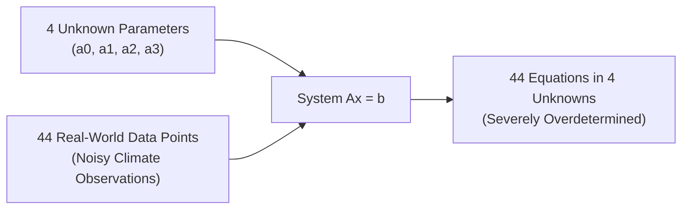
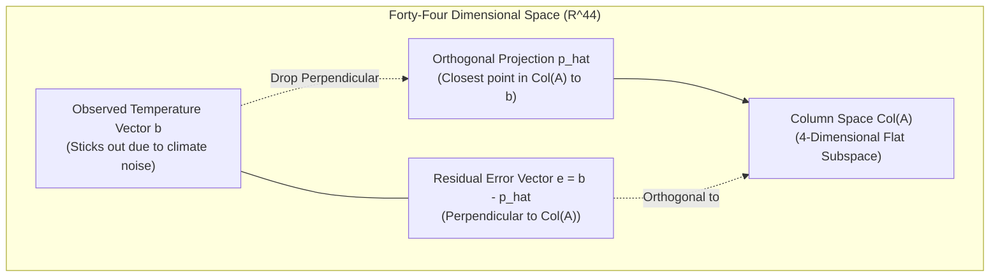
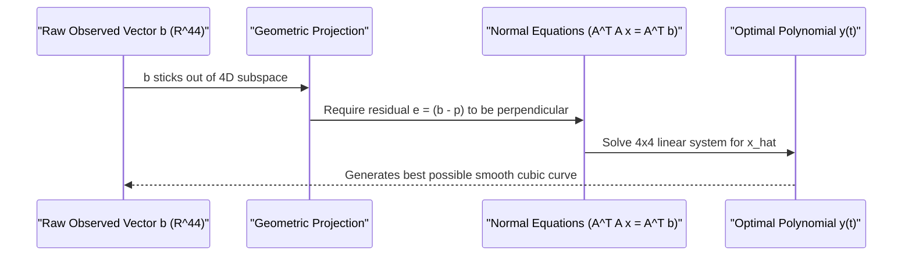
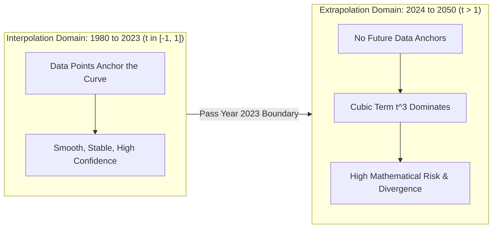
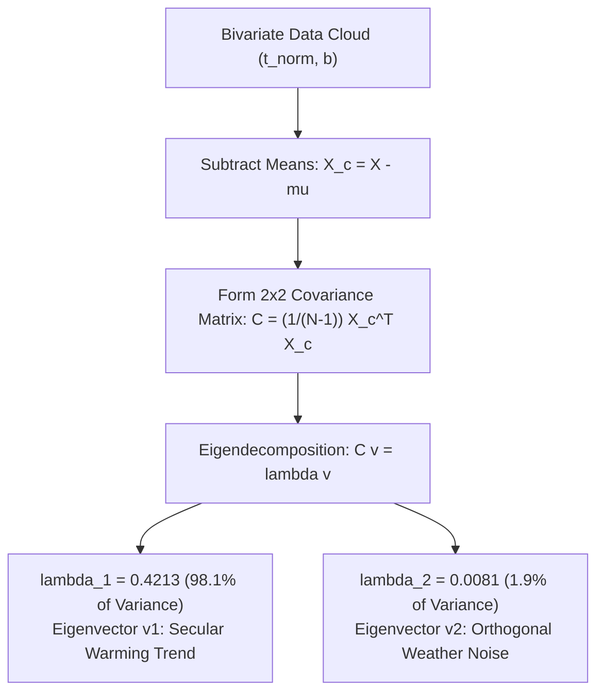

# Intuitive Guide to the Climate Change Linear Algebra Project

## The Big Picture Question

Start by forgetting matrices, vectors, and theorems for just one minute. 

Look at what we actually have: forty-four numbers representing global temperature anomalies measured by NASA from 1980 to 2023. If you plot them on a sheet of paper with years on the horizontal axis and temperature on the vertical axis, you see a jagged, noisy line that crawls steadily upward by about one degree Celsius over four decades.

Now suppose someone asks you two questions. First, what was the temperature in the middle of 1995, even if no single annual average sits precisely on July 1st? Second, what is the temperature likely to look like in 2030 or 2050 if this trajectory keeps moving?

The first question is interpolation. The second question is extrapolation. Both questions require drawing a smooth mathematical curve through that noisy scatter plot. 

The entire goal of this project is to figure out how to draw that curve without using any machine learning shortcuts, black-box libraries, or magical formulas, but purely through the geometric machinery of linear algebra.

---

## The Trap of Trying to Fit Data Exactly

When you first learn curve fitting in school, you are taught that two points define a unique line, three points define a unique parabola, and four points define a unique cubic polynomial.

So your first instinct might be: let us just find a cubic polynomial that passes through our data points. A cubic polynomial has the equation:

$$y(t) = a_0 + a_1 t + a_2 t^2 + a_3 t^3$$

Notice something here — this equation has exactly four unknown knobs you can turn: the coefficients $a_0, a_1, a_2$, and $a_3$.

Now here is the thing. We do not have four data points. We have forty-four data points. 

If you demand that one cubic curve must pass through every single one of those forty-four points simultaneously, you are demanding that four unknown numbers satisfy forty-four separate equations at the same time.

The moment you write down forty-four equations for four unknowns, basic algebra tells you that unless all forty-four points lie on an impossibly pristine, frictionless mathematical curve, no solution exists. 

Real-world temperatures fluctuate because of volcanic dust, El Nino cycles, and ocean currents. The data is noisy. The points will never line up perfectly.

---

## Converting the Physical Problem into a Matrix Equation

To see this problem clearly, we translate our forty-four individual equations into a single compact matrix equation:

$$A x = b$$

Here is how each piece maps directly to reality.

The vector $b$ on the right side is simply the list of our forty-four observed temperatures stacked vertically into a column vector in forty-four dimensional space ($\mathbb{R}^{44}$).

The vector $x$ is the column of four unknown polynomial coefficients $[a_0, a_1, a_2, a_3]^T$ living in $\mathbb{R}^4$.

The matrix $A$ is our design matrix. Each row corresponds to a specific year, and the four columns represent the polynomial powers of time evaluated at that year: the constant term $1$, the linear term $t$, the quadratic term $t^2$, and the cubic term $t^3$. Because of this power structure, mathematicians call $A$ a Vandermonde matrix.

$$\begin{bmatrix} 1 & t_1 & t_1^2 & t_1^3 \\ 1 & t_2 & t_2^2 & t_2^3 \\ \vdots & \vdots & \vdots & \vdots \\ 1 & t_{44} & t_{44}^2 & t_{44}^3 \end{bmatrix} \begin{bmatrix} a_0 \\ a_1 \\ a_2 \\ a_3 \end{bmatrix} = \begin{bmatrix} b_1 \\ b_2 \\ \vdots \\ b_{44} \end{bmatrix}$$

Notice something important about the time variable $t$. If you plug raw calendar years like 2023 directly into $A$, the fourth column contains numbers like $2023^3 \approx 8.27 \times 10^9$. 

When you later compute $A^T A$, you end up multiplying terms like $t^3 \times t^3 = t^6$, producing numbers on the order of $10^{19}$. Meanwhile, the first column only contains ones. 

Mixing numbers like $1$ and $10^{19}$ inside the same matrix creates massive numerical instability, known as an astronomical condition number. Computers start rounding off critical digits, and Gaussian elimination produces pure garbage.

So what do we do? We normalize the calendar years. We map the entire forty-four-year span from 1980 to 2023 into the neat interval between $-1.0$ and $+1.0$. Now, every single number inside matrix $A$ stays strictly between $-1$ and $+1$. Floating-point rounding errors vanish, and the matrix operations remain rock solid.

---

## Watching the System Break: Gaussian Elimination and RREF

Alright, so we have built $Ax = b$. We suspect there is no exact solution, but how do we prove it mathematically?

We use Gaussian elimination with partial pivoting to reduce our matrix to Reduced Row Echelon Form (RREF). 

Think about what RREF actually does. It is a systematic process of row addition and scaling that reveals the true underlying relationships between equations, stripping away all redundancies.

When we compute the RREF of the coefficient matrix $A$ alone, we find four leading ones (pivots). That means all four columns are linearly independent, giving $\text{rank}(A) = 4$. So far, so good.

But look at what happens when we attach our observed temperature vector $b$ to the right side and compute the RREF of the augmented matrix $[A \mid b]$.

The first four rows look normal. But look at the fifth row. The left side is all zeros, but the right side has a non-zero number:

$$\begin{bmatrix} 0 & 0 & 0 & 0 & \mid & 1 \end{bmatrix}$$

Translate that row back into an ordinary algebraic equation. It is saying:

$$0 \cdot a_0 + 0 \cdot a_1 + 0 \cdot a_2 + 0 \cdot a_3 = 1 \implies 0 = 1$$

This is a flat-out mathematical contradiction. 

Counting the pivot rows in $[A \mid b]$ gives five pivots, meaning $\text{rank}([A \mid b]) = 5$. 

By the classical Rouche-Capelli theorem, whenever $\text{rank}(A) < \text{rank}([A \mid b])$, the system is strictly inconsistent. No combination of coefficients can ever satisfy the equations. The system is dead on arrival.

---

## The Geometry of Why It Failed: Subspaces and Shadows

Now, do not treat that inconsistency as a dead end. Treat it as a geometric map. 

Ask yourself: why did the system fail geometrically?

Our temperature observation vector $b$ has forty-four entries. That means $b$ is a single arrow pointing somewhere in forty-four dimensional space ($\mathbb{R}^{44}$).

Now think about what $A x$ actually does. Matrix multiplication $A x$ is just a recipe for taking linear combinations of the columns of $A$:

$$A x = a_0 \mathbf{a}_0 + a_1 \mathbf{a}_1 + a_2 \mathbf{a}_2 + a_3 \mathbf{a}_3$$

The set of all possible outputs our model can ever generate is the column space of $A$, written $\text{Col}(A)$. 

Because $A$ has four linearly independent columns, $\text{Col}(A)$ is a 4-dimensional flat subspace cutting through forty-four dimensional space.

Think of this like a flat tabletop sitting in a three-dimensional room. The tabletop is a 2D subspace. If you hold a tennis ball up in the air above the table, that tennis ball is vector $b$. 

Can you touch the tennis ball while keeping your finger glued to the tabletop? No. The tennis ball does not lie on the table. That is why $Ax = b$ has no exact solution: vector $b$ is floating out in forty-four dimensional space, sticking out of the 4D subspace.

What about the null space of $A$? The null space consists of any coefficient vector $x$ that produces zero: $Ax = \mathbf{0}$. 

By the Rank-Nullity theorem, $\text{nullity}(A) = \text{columns} - \text{rank} = 4 - 4 = 0$. 

The null space contains only the zero vector. Physically, that is fantastic news: it means there is no wiggle room or ambiguity in our four polynomial terms. Once we find our best fit, that fit is guaranteed to be unique.

---

## Dropping the Perpendicular: Orthogonal Projection

So the tennis ball is hovering above the tabletop. What is the smartest thing we can do?

We look directly down from the ball and find the point on the tabletop that is closest to it. That point is the shadow of the ball on the table: the orthogonal projection, denoted $\hat{p}$.

Because $\hat{p}$ lies flat on the table, it lives inside $\text{Col}(A)$. That means there really is some coefficient vector $\hat{x}$ such that:

$$\hat{p} = A \hat{x}$$

Look at the error vector connecting the shadow to the actual ball:

$$e = b - \hat{p} = b - A \hat{x}$$

Notice the geometry here. If $\hat{p}$ is truly the closest point on the table to $b$, the error vector $e$ must be straight up and down. It must be perpendicular (orthogonal) to every single direction on the table.

Because the columns of $A$ span the entire tabletop, $e$ must be orthogonal to every column of $A$. In linear algebra, orthogonal means the dot product is zero:

$$A^T e = \mathbf{0}$$

Now substitute $e = b - A \hat{x}$ into that orthogonality condition:

$$A^T (b - A \hat{x}) = \mathbf{0}$$

Expand the brackets:

$$A^T b - A^T A \hat{x} = \mathbf{0}$$

Move $A^T A \hat{x}$ to the other side:

$$A^T A \hat{x} = A^T b$$

Notice what just happened. The famous Normal Equations of least squares were not invented by magic or arbitrary curve-fitting rules. They are simply the direct algebraic translation of dropping a perpendicular shadow onto a subspace.

Because $A$ has full column rank, the $4 \times 4$ matrix $A^T A$ is guaranteed to be invertible. Solving this $4 \times 4$ system gives our optimal polynomial coefficients:

$$a_0 \approx 0.5103, \quad a_1 \approx 0.4325, \quad a_2 \approx 0.1151, \quad a_3 \approx -0.0203$$

The length of the error vector, $\|e\| \approx 0.5971$, is the shortest possible geometric distance from reality to our cubic model. 

Comparing that error to the total variance of the data gives an $R^2$ of $0.8857$. That means our 4D subspace captures $88.57\%$ of everything that happened to global temperatures over the last forty-four years.

---

## Straightening the Axes: Gram-Schmidt Orthogonalization

Now, think about this from a computational perspective. 

To solve $A^T A \hat{x} = A^T b$, we have to form $A^T A$ and invert it. But why were the columns of $A$ messy in the first place?

Because the monomial columns of $A$ ($1, t, t^2, t^3$) are not perpendicular. On the interval $[-1, 1]$, the column for $1$ and the column for $t^2$ point somewhat in the same direction. They are skewed, like trying to build a grid system using chopsticks that meet at twenty-degree angles instead of ninety degrees.

Gram-Schmidt orthogonalization is a procedure that takes those skewed vectors and systematically straightens them into an orthonormal basis:

$$Q = \begin{bmatrix} q_0 & q_1 & q_2 & q_3 \end{bmatrix}$$

Here is how the algorithm works mentally. 

You take the first column of $A$ and divide it by its length to make it a unit vector. That is $q_0$.

Then you take the second column of $A$. It probably has some component pointing along $q_0$. You calculate that projection, subtract it off, and whatever remains is guaranteed to be perpendicular to $q_0$. You normalize that remainder to get $q_1$.

You repeat this process for the third and fourth columns, subtracting off their projections onto all preceding $q$ vectors before normalizing.

| Basis Vector | Starting Column | Subtraction Step | Physical Property |
| :--- | :--- | :--- | :--- |
| $q_0$ | Column 0 ($1$) | None | Unit length baseline |
| $q_1$ | Column 1 ($t$) | Subtract projection onto $q_0$ | Orthogonal to $q_0$ |
| $q_2$ | Column 2 ($t^2$) | Subtract projections onto $q_0, q_1$ | Orthogonal to $q_0, q_1$ |
| $q_3$ | Column 3 ($t^3$) | Subtract projections onto $q_0, q_1, q_2$ | Orthogonal to $q_0, q_1, q_2$ |

Once you finish, you have factored our matrix into:

$$A = Q R_{\text{gs}}$$

where $Q$ has orthonormal columns ($Q^T Q = I_4$) and $R_{\text{gs}}$ is an upper-triangular matrix holding the projection coefficients.

Why does this matter? Because once your basis is orthonormal, projecting any vector $b$ onto the subspace becomes trivial:

$$\hat{p} = Q Q^T b$$

There is no matrix inversion required. You avoid all risk of ill-conditioned matrices. Gram-Schmidt gives us a clean, perpendicular coordinate frame for our 4-dimensional subspace.

---

## Interpolation Versus Extrapolation: The Danger Zone

Now that we have our optimal cubic curve:

$$y(t) = 0.5103 + 0.4325t + 0.1151t^2 - 0.0203t^3$$

we can finally use it to answer our original questions.

First, look at interpolation. Suppose we evaluate this formula at year 2000.5 (which maps to $t \approx -0.0465$). The formula outputs approximately $+0.4904^\circ\text{C}$. 

We can trust this number. Why? Because year 2000.5 sits comfortably inside our training domain of $[-1, 1]$. It is bounded on the left by the year 2000 observation ($+0.39^\circ\text{C}$) and on the right by the year 2001 observation ($+0.54^\circ\text{C}$). The polynomial is anchored on both sides by real physical data.

Now look at extrapolation. Suppose we march forward to year 2040 ($t \approx 1.79$) or year 2050 ($t \approx 2.26$). 

The formula predicts $+1.54^\circ\text{C}$ for 2040 and $+1.84^\circ\text{C}$ for 2050. It suggests that global warming will cross the critical $+1.5^\circ\text{C}$ Paris Agreement threshold around 2038 to 2040.

But here is where you must be intellectually honest as a student. 

Outside the interval $[-1, 1]$, polynomials are notorious wild beasts. As $t$ grows larger than $1$, the cubic term $t^3$ grows exponentially faster than the linear term. Any tiny error or noise in your estimated coefficients gets amplified dramatically as you move further away from the data boundary.

Furthermore, our model only knows about time. It knows nothing about greenhouse gas concentrations, ocean heat capacity, atmospheric chemistry, or climate policy. 

Polynomial extrapolation is a useful baseline, but it is purely descriptive, not predictive. Real climate prediction requires thermodynamics and fluid dynamics, not just polynomials.

---

## Changing Perspective: Covariance and Eigenanalysis

Up to this point, our approach has been supervised regression: we decided in advance that time is the input and temperature is the output.

Now let us step back and look at the data without that assumption. 

Imagine you take all forty-four points and plot them in a two-dimensional plane: normalized time on the horizontal axis, temperature on the vertical axis. You get an elongated, tilted cloud of points stretching from the bottom-left to the top-right.

To understand the shape of this cloud, we first center it by subtracting the average time and average temperature. This moves the center of mass of the cloud directly to the origin $(0, 0)$.

Next, we compute the sample covariance matrix:

$$C = \frac{1}{N - 1} X_c^T X_c = \begin{bmatrix} 0.356950 & 0.149843 \\ 0.149843 & 0.072521 \end{bmatrix}$$

Notice two things about matrix $C$. First, the diagonal numbers are the individual variances of time and temperature. Second, the off-diagonal numbers are positive ($0.1498$). That positive covariance tells us mathematically that as time increases, temperature tends to increase.

Now ask the geometric question: if this cloud of points forms an ellipse, what are the primary directions of that ellipse, and how wide is it along each direction?

That is precisely what eigenvalues and eigenvectors calculate.

An eigenvector of $C$ is a direction where multiplying by $C$ does not rotate the vector, but merely stretches it by a factor $\lambda$ (the eigenvalue):

$$C v = \lambda v$$

Because $C$ is a real symmetric matrix ($C = C^T$), the Spectral Theorem guarantees that its eigenvalues are real and its eigenvectors are perpendicular to each other.

Solving the characteristic equation $\det(C - \lambda I) = 0$ yields two eigenvalues:

$$\lambda_1 = 0.421322, \quad \lambda_2 = 0.008149$$

Look at those two numbers. The total variance in our cloud is the sum of the eigenvalues:

$$\text{Total Variance} = \lambda_1 + \lambda_2 = 0.421322 + 0.008149 = 0.429471$$

Compute the proportion of variance explained by the first eigenvalue:

$$\frac{\lambda_1}{\text{Total Variance}} = \frac{0.421322}{0.429471} = \mathbf{98.10\%}$$

This is the most striking mathematical insight of the entire project. 

The first eigenvalue accounts for $98.10\%$ of all variation in the data. Its eigenvector points diagonally upward. It captures the continuous, multi-decadal global warming signal.

The second eigenvalue accounts for only $1.90\%$ of the variance. Its eigenvector points perpendicular to the warming line. It captures the natural, year-to-year scatter of weather, volcanic eruptions, and measurement noise.

Linear algebra shows that forty-four years of global climate records are, to a ninety-eight percent approximation, entirely a one-dimensional line.

---

## The Clean Finish: Matrix Diagonalization

Now, look at what diagonalization does with this result.

In our original coordinate system of time and temperature, the two variables are correlated. The off-diagonal entries in $C$ are non-zero. If someone tells you the year, it changes your expectation of the temperature.

Diagonalization is the process of rotating our coordinate axes so that the variables become completely uncorrelated:

$$C = P D P^T$$

The matrix $P$ is formed by placing our two normalized eigenvectors side by side as columns. Because the eigenvectors are perpendicular and unit length, $P$ is an orthogonal matrix, meaning $P^{-1} = P^T$.

The matrix $D$ is a diagonal matrix holding the eigenvalues:

$$D = \begin{bmatrix} \lambda_1 & 0 \\ 0 & \lambda_2 \end{bmatrix} = \begin{bmatrix} 0.421322 & 0 \\ 0 & 0.008149 \end{bmatrix}$$

Notice what $D$ looks like. The off-diagonal covariance is literally zero.

When we transform our centered climate data into this new eigenvector coordinate system ($Z = X_c P$), the covariance matrix of $Z$ is exactly $D$. 

In this rotated coordinate frame, the two physical processes are decoupled. One axis measures pure climate trend. The other axis measures pure climate noise. They do not interfere with each other.

This is why linear algebra is so powerful. It takes a messy real-world phenomenon where time, warming, and noise are hopelessly tangled together, and systematically decomposes it into independent, orthogonal physical components.

---

## Key Takeaways

The entire project follows one continuous logical chain:

- We began with forty-four noisy temperature observations from NASA and wanted to fit a cubic polynomial.
- Writing the equations as $Ax = b$ produced forty-four equations for four unknowns, an overdetermined system.
- Normalizing the years to $[-1, 1]$ prevented catastrophic floating-point cancellation in our Vandermonde matrix.
- Gaussian elimination and RREF revealed a contradictory row ($0 = 1$), proving that the system has no exact solution because observation vector $b$ sticks out of the 4D column space $\text{Col}(A)$.
- We resolved this inconsistency by computing the orthogonal projection $\hat{p}$ of $b$ onto $\text{Col}(A)$, which led directly to the Normal Equations $A^T A \hat{x} = A^T b$.
- Gram-Schmidt orthogonalization converted our skewed monomial columns into an orthonormal basis $Q$, enabling stable projection without matrix inversion.
- Our fitted cubic polynomial explained $88.57\%$ of historical temperature variance ($R^2 \approx 0.886$).
- Interpolation within 1980 to 2023 is mathematically stable, while extrapolation to 2050 carries inherent divergence risks due to the cubic term and missing physical drivers.
- Eigendecomposition of the covariance matrix revealed that the first principal component accounts for $98.10\%$ of all data variance, mathematically proving that global warming is the overwhelming dominant signal behind four decades of climate records.
- Diagonalization ($C = P D P^T$) rotated our coordinate system to decouple the continuous warming trend from short-term annual climate noise.
